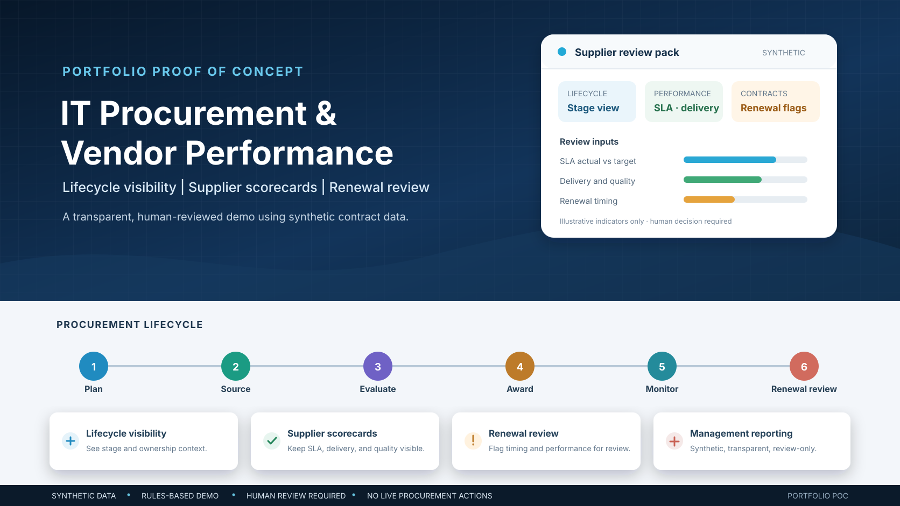

# IT Procurement & Vendor Performance Management

A runnable, synthetic-data proof of concept for procurement lifecycle visibility, supplier scorecards, and contract-renewal review.

> **Scope:** This is a local, deterministic rules-based demonstration, not an AI model or procurement system. It uses fictional contract and supplier records. It has no finance, ERP, ITSM, contract-management, or vendor-system integration and executes no procurement actions. Every flag requires human review.

## What it demonstrates

- Lifecycle visibility across planning, tender, evaluation, award, active contract, renewal review, and closed stages.
- Transparent supplier scorecards based on declared SLA attainment, on-time delivery, and quality measures.
- Contract renewal flags for dates within 90 days or already passed.
- Additional review prompts for SLA misses and repeated open major issues.
- CSV scorecards and renewal flags, a JSON management summary, and a blank human-review template.
- Unit tests for validation, scoring, renewal boundaries, reports, and synthetic sample behavior.

The score is a review aid, not a calibrated supplier rating or a procurement decision. The program does not rank suppliers for award, approve renewals or payments, contact vendors, or interpret contract text.

## Quick start

Requires Python 3.10 or later; no third-party packages.

```bash
python -m venv .venv
# Windows PowerShell:
.\.venv\Scripts\Activate.ps1
# macOS/Linux:
# source .venv/bin/activate

python -m unittest discover -v
python -m procurement_poc.cli --input data/contracts.csv --output-dir reports --as-of 2026-10-26
```

The fixed `--as-of` date makes the sample output reproducible. Omit it to use today's date.

## Sample run

The bundled CSV contains eight fictional contract records. The verified local run assessed 8 records from 8 fictional suppliers: 2 renewal dates were within 90 days, 1 date had passed, 4 records had review flags, 5 records were scored, all 8 required human review, and 0 actions were executed. The synthetic annual-value total was EUR 158,500. These are fixture outputs only, not supplier results, budgets, savings, or procurement recommendations.

## Generated files

- `reports/supplier_scorecards.csv` — lifecycle stage, declared metrics, weighted score, status, and review reasons.
- `reports/contract_renewal_flags.csv` — records with at least one review reason.
- `reports/management_summary.json` — stage counts, renewal counts, review counts, synthetic annual values, and limitations.
- `reports/human_review_template.csv` — blank fields for a person to record a later decision; the program does not fill or approve them.

Reports repeat the input values. Use fictional examples only.

## Scoring and flags

For records with performance metrics, the illustrative score is:

```text
40% SLA actual + 35% on-time delivery + 25% quality pass rate
```

A score below 80, SLA actual below the stated target, or three or more open major issues triggers a review status. Scores below 92 or any open major issue receive a watch status unless a stronger review condition applies. Renewal dates within 90 days and dates in the past are flagged separately. The scoring notes and limits are in [`docs/SCORING_MODEL.md`](docs/SCORING_MODEL.md).

## Data and governance

All supplier names, contract IDs, metrics, and EUR values are fictional. The values are not quotes, invoices, budgets, negotiated terms, or real supplier records. See [`docs/DATA_DICTIONARY.md`](docs/DATA_DICTIONARY.md) and [`docs/OPERATING_MODEL.md`](docs/OPERATING_MODEL.md).

Before operational use, an organization would need approved data sources, supplier-specific SLA definitions, procurement and finance controls, legal review, delegated approval authority, privacy/security safeguards, and a human-validated evaluation set. This demo provides none of those integrations or approvals.

## Repository structure

```text
.
├── data/contracts.csv
├── docs/
│   ├── DATA_DICTIONARY.md
│   ├── OPERATING_MODEL.md
│   ├── SCORING_MODEL.md
│   ├── LINKEDIN_ARTICLE.md
│   ├── LINKEDIN_SHORT_POST.md
│   ├── LINKEDIN_GROUPS_POST.md
│   ├── LINKEDIN_NETWORK_BLURB.md
│   ├── RUN_PROOF.md
│   └── images/
│       └── it-procurement-vendor-management-banner.svg
├── procurement_poc/
│   ├── __init__.py
│   ├── assessment.py
│   ├── cli.py
│   └── io.py
├── reports/                       # generated locally
├── tests/
│   ├── __init__.py
│   └── test_assessment.py
├── .github/workflows/tests.yml
├── .gitignore
└── README.md
```

## CI status

The GitHub Actions test workflow is at `.github/workflows/tests.yml` (Python 3.10–3.13: unit tests and the synthetic CLI run, with summary assertions). Its first remote run has not yet been verified; no remote CI result is claimed.

## Next steps

- Review the categories and synthetic field definitions with procurement, service owners, finance, and legal stakeholders.
- Replace the illustrative score only after agreeing measurable, locally appropriate criteria and an evaluation method.
- Add no real data, integration, supplier communication, or write capability without explicit authorization and controls.
- Treat any future AI feature as a separate proposal; the current demo is rules-based.

## LinkedIn article

[`docs/LINKEDIN_ARTICLE.md`](docs/LINKEDIN_ARTICLE.md) is an unpublished draft. The repository includes separate feed, group, and share-blurb drafts; none have been published.

## Disclaimer

This is an educational portfolio proof of concept using synthetic data. It does not establish supplier quality, operational benefit, production suitability, or a basis for sourcing, renewal, payment, or contract decisions.
